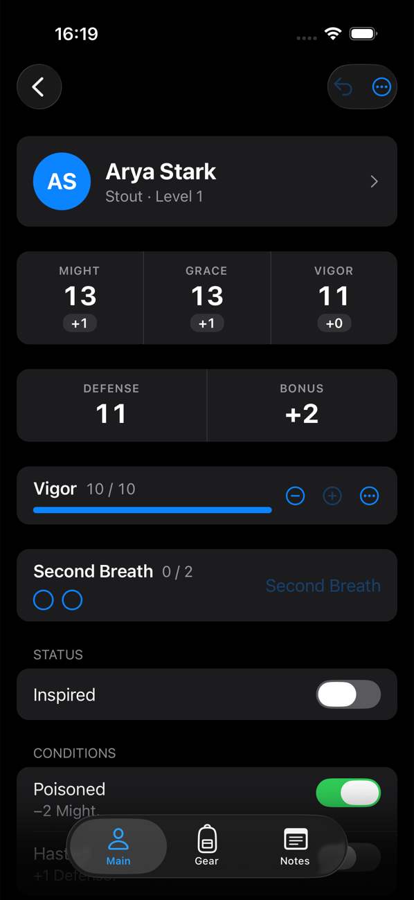
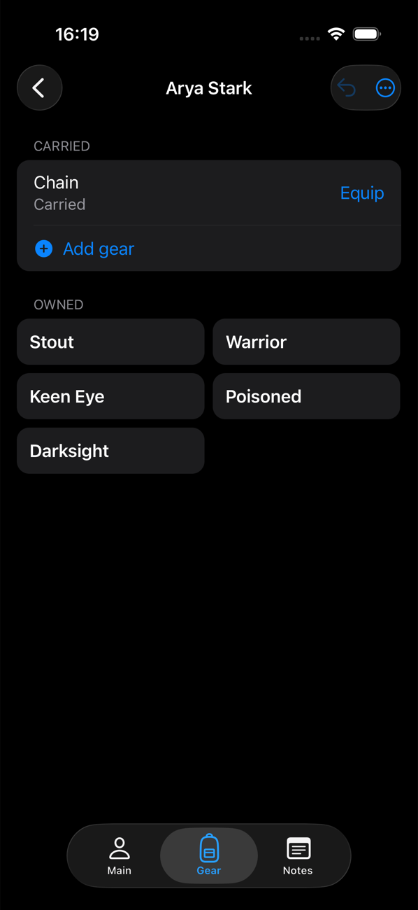
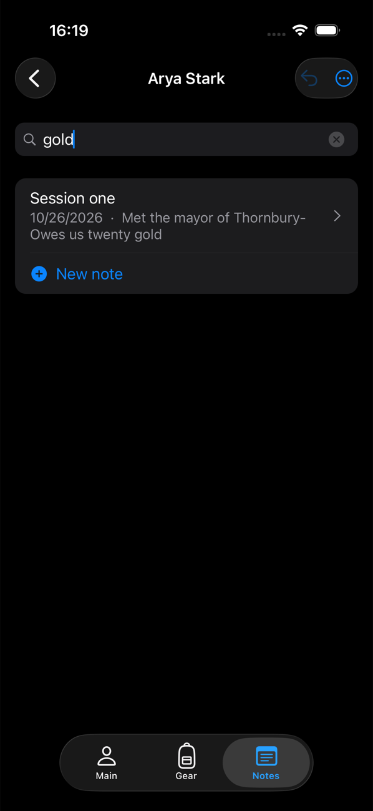
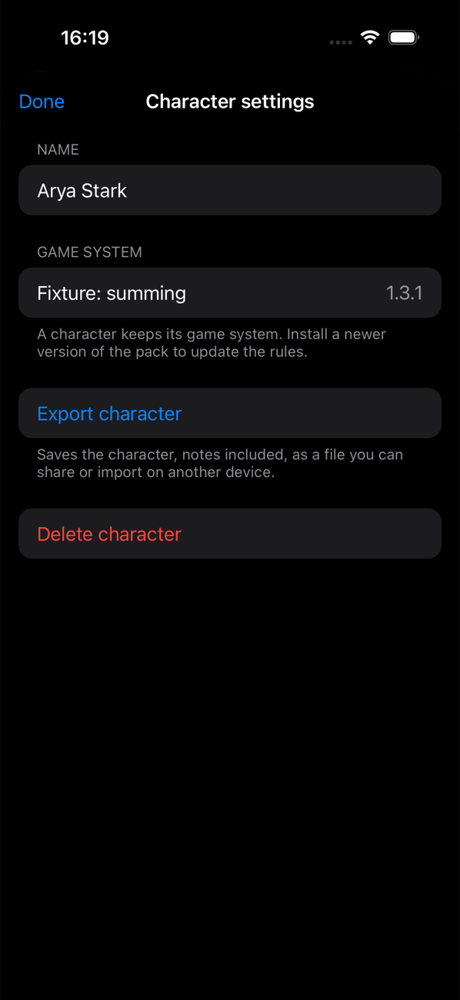
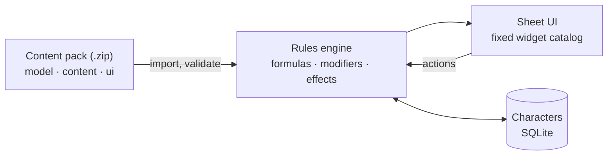

# Tome

**A character manager for tabletop RPGs that knows no rules until you give it some.**

Tome is an iOS and Android app for running your tabletop characters. It ships with no game content and no game rules. Everything a sheet shows and does (stats, modifiers, resources, level-ups, the creation wizard, even the tabs) comes from a **content pack**: a zip of JSON files you import. One app, any game system: D&D 5e (2014 and 2024 SRD), Daggerheart, and Pathfinder 2e are on the roadmap, all as packs.


<p align="center">
  
  
  
  
</p>

## Highlights

- **System-agnostic by design.** The app contains no game-system code. A pack declares the character's data, rules, sheet layout, buttons and forms; the app renders and runs them.
- **Packs are data, never code.** JSON plus a small, safe formula language with an evaluation budget, so importing a pack can't run anything or freeze the app.
- **Rules you can inspect.** Every modified value can explain itself: tap a stat to see its base value and each bonus, in the order they apply.
- **Native look and feel.** Inset grouped lists, native menus and a native tab bar per character, with compact sheet-style stat blocks.
- **Creation wizard and level-up** driven by the pack: point buy, standard array, choices that depend on earlier steps, and a live preview before you create.
- **Undo** for every change, serialized writes, and optimistic concurrency so a character is never silently overwritten.
- **Searchable notes** per character, written in markdown with a native rich-text editor.
- **Offline and yours.** Characters live on the device in SQLite and export to a portable `.tome.json` file.

## How it works



A pack has a fixed layout: `model/` (character fields, derived values, resources, constraints, tables), `content/` (entities such as classes, items and spells), and `ui/` (sheet tabs, actions, modals, the creation wizard). Expansions extend a game system by adding entities and patching existing ones. Characters pin pack versions with semver ranges, so a pack update never breaks a character unexpectedly.

The full design, including the pack format, the formula language and the widget catalog, is in [`docs/SPEC.md`](docs/SPEC.md).

## Getting started

Tome uses native modules, so it runs in an Expo **development build**, not Expo Go.

```bash
npm install
npx expo run:ios        # or: npx expo run:android
```

The app starts empty. Import a content pack from the **Packs** tab to create your first character.

| Script | What it does |
| --- | --- |
| `npm start` | Start the Metro bundler |
| `npm test` | Run the engine and data tests (Jest) |
| `npm run typecheck` | Type-check with `tsc` |
| `npm run lint` | Lint with ESLint |
| `npm run tome-pack -- build packs/dnd5e-2014` | Validate a pack and zip it into `dist/` |

## Packs

[`packs/dnd5e-2014`](packs/dnd5e-2014) is the full D&D 5e SRD 5.1 (CC-BY-4.0): all 12 classes to level 20, races, 319 spells, 722 items. Its content is generated from the 5e-bits SRD data by `npm run pack:srd2014`; rules the SRD only states in prose come from hand-written overrides. Build the zip with `npm run tome-pack -- build packs/dnd5e-2014`, put it on the device, and import it from the Packs tab. [`docs/gaps.md`](docs/gaps.md) tracks what the app can't express yet.

## Project structure

```
src/
  engine/   rules engine: pure TypeScript, no React or Expo (formulas, pack loading, effects)
  data/     storage adapter (SQLite), pack install and resolution, character import/export
  ui/       app-owned components and the sheet's widget catalog
  app/      screens (expo-router)
packs/      content packs, one folder each
tools/      tome-pack CLI and the SRD pack generator
docs/
  SPEC.md   design and pack format
  gaps.md   app gaps found while writing packs
```

## Roadmap

- [x] Rules engine, pack format and validation
- [x] Pack import, versions and uninstall
- [x] Character sheet, undo and modifier breakdown
- [x] Creation wizard and level-up
- [x] Notes, conditions, character settings, export and import
- [x] D&D 5e 2014 SRD pack
- [ ] D&D 5e 2024 SRD pack
- [ ] Daggerheart pack
- [ ] Pathfinder 2e

## License

[MIT](LICENSE) © Joeri Dijkstra. Game content in packs is licensed separately by each pack.
