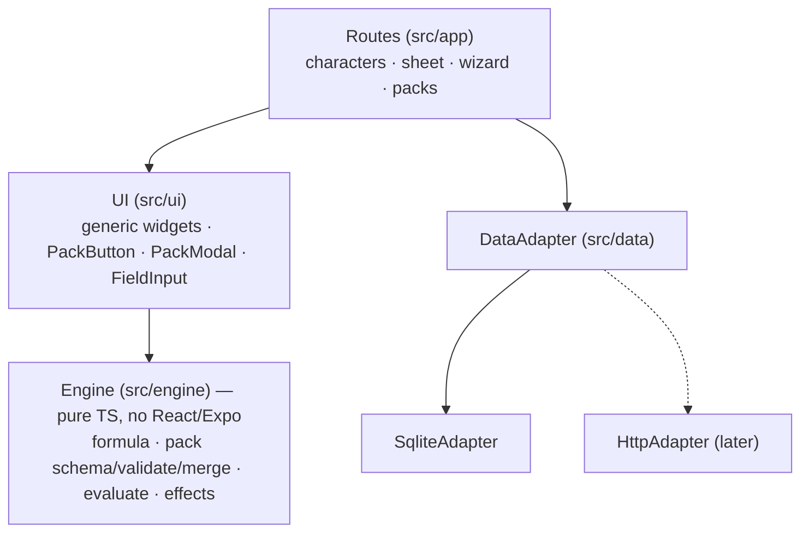
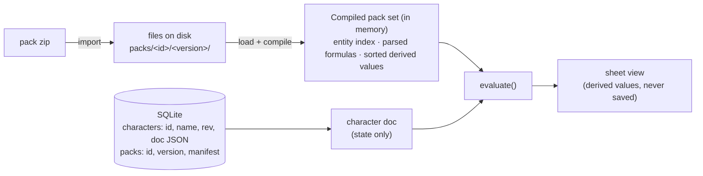
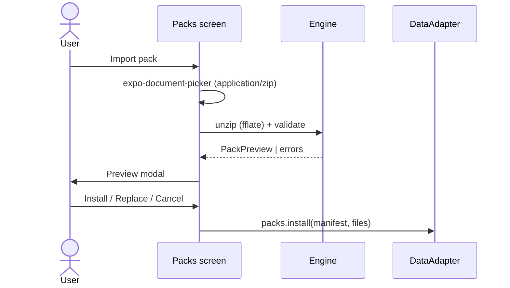

# Tome — spec

A TTRPG character manager for iOS and Android. **Goal: run D&D, Pathfinder 2e,
Daggerheart and any other system from the same app, side by side.** The app knows nothing about any
game system. All rules, character data shape, sheet layout, buttons and modals
come from **content packs**: zip files with a `manifest.json`, installed through
an import dialog. **The app ships no content.** Each pack, including the two
D&D packs, lives in its own folder under `packs/` and is built into a zip that
you import yourself, one pack at a time.

Status: draft.

## Decisions

| Topic | Decision |
|---|---|
| Target systems | D&D 5e (2014 and 2024) first, then Daggerheart, then Pathfinder 2e. The format has to cover all three from `schema_version` 1, which is why it has typed modifier stacking, formula fields on entities, grants and constraints. |
| Stack | Expo SDK 58, expo-router, TypeScript. iOS + Android only. |
| Rules logic | Declarative JSON plus a safe formula language. Packs contain no code. |
| Sheet UI | Packs build tabs and sections from a fixed widget catalog. The app owns how widgets look and work: native structure (inset grouped lists, a segmented control for tabs, native menus) with compact character-sheet stat blocks. Sheet-wide actions (`sheet.header.actions`) live in the header's ••• menu; other actions sit on the widget they belong to. |
| Buttons / modals | Generic. Every in-sheet button is a pack `action`, and every in-sheet modal is a pack `modal`. |
| Theming | App theme only. Packs cannot theme the app. |
| Major / expansion | One major per character. Expansions add new entities and patch existing ones by id. They cannot delete anything. |
| Versioning | Packs have a semver `version` and an integer `schema_version`. A character pins a semver **range** and always uses the newest installed version that matches. |
| Storage | `DataAdapter` interface. v1 ships `SqliteAdapter` (expo-sqlite, JSON documents). An `HttpAdapter` can replace it later. |
| D&D | Two separate major packs, `dnd5e-2014` (SRD 5.1) and `dnd5e-2024` (SRD 5.2.1). v1 is a vertical slice of each and is single-class only. |
| Multiclass | The engine supports it (`classes` is a map keyed by class id). The v1 D&D slices don't offer it. A pack update can add it later without app changes. |
| Undo | Undo the last effect batch, kept in memory up to 20 deep for each open character. The history is lost on restart. |
| Notes | Simple rich text using `react-native-enriched-html`, stored as HTML. Pack prose (descriptions, `text` widget) is markdown, rendered with `react-native-enriched-markdown`. |

### v1 features

- Pack-driven creation wizard
- Level-up flow
- Inventory, equipment and currency
- Spellcasting and resources (slots, class resources, HP, rests)
- Conditions and effects
- Notes / journal (simple rich text) for each character
- Character export and import (JSON file)
- Pack manager with import dialog, details view and uninstall

### Not in v1

- Dice roller and roll log. This was not picked. `roll` fields can show a
  formula as text, such as `1d8+3`, but nothing gets rolled.
- Pack theming, monsters / bestiary, party and campaign views, sync, accounts.
- Companions as full sub-sheets (PF2e animal companions and familiars, the
  Daggerheart Ranger companion, D&D familiars). A simple companion works in v1
  as an object field on the parent, with its own derived values. The field type
  name `sheet` is reserved for nested sub-characters in a later
  `schema_version`.
- A pack editor. Packs are written by hand as JSON.

## Prior art

| Tool | Platform | Systems | How content is extended | Gap Tome fills |
|---|---|---|---|---|
| [Fight Club 5e](https://play.google.com/store/apps/details?id=com.lionsden.fc5) | iOS, Android | D&D 5e only | Imports compendium XML; community repo [FightClub5eXML](https://github.com/kinkofer/FightClub5eXML) | The closest mobile match. Its data is content only: the rules and sheet are hard-coded for 5e, and there's no pack or schema versioning. |
| [D&D Beyond](https://www.dndbeyond.com) | Web, iOS, Android | D&D only | Purchased books and web homebrew forms | Closed and server-only. No offline packs, no other systems. |
| [Aurora Builder](https://aurorabuilder.com/content/) | Windows | D&D 5e | XML "elements" plus index files pulled from URLs and kept updated | Desktop only and 5e only. Rules live in the app; the XML only adds content. |
| [PCGen](https://github.com/PCGen/pcgen) | Java desktop | Multi (d20 family) | LST data files and game modes; `.MOD`/`.COPY`/`.FORGET` to modify other data | Desktop only. A d20-shaped engine with a dated, hard-to-author format. |
| [Hero Lab Online](https://www.wolflair.com/hero-lab-online-faq) | Web | Multi (licensed) | Paid data packages from the vendor | Proprietary. Users can't author packs. |
| [DiceCloud](https://github.com/ThaumRystra/DiceCloud) | Web (GPL) | D&D 5e-focused | In-app formulas and effects on each character, plus libraries | Server-backed web app. Rules are attached to characters, not packaged as a versioned ruleset. |
| [Let's Role](https://www.lets-role.wiki/index.php/System_Builder) | Web | Any | Online System Builder (sheet layout + scripts) | Online platform, so packs aren't portable files. VTT-first. |
| [Foundry VTT](https://foundryvtt.com/article/package-management/) | Desktop/server VTT | Any | `system.json` / `module.json` manifests with `compatibility` and `relationships` | A full VTT, not a mobile character manager. Packages ship JavaScript. |
| [BattleScribe / BSData](https://battlescribedata.appspot.com/) | Desktop, mobile | Wargames | Game system (`.gst`) + catalogues (`.cat`) XML | Army list building, not RPG characters. Structurally the closest analogue to major + expansion packs. |

How Tome is different, taken together:

- **The pack defines the whole character sheet**, not only the content. That
  includes the character's data shape, rules formulas, sheet layout, buttons,
  modals, the creation wizard and level up. Fight Club 5e and Aurora import
  content into an app whose 5e rules are fixed in code.
- **Packs are data only.** They are JSON plus a formula language that can't run
  code. Foundry and Let's Role packages run scripts. Tome packs are safe to
  import from anywhere.
- **It works offline on mobile, and the files are portable.** A pack is one
  zip you can share. There's no account, and a server adapter is optional.
- **Versioning is explicit on both sides.** A pack has a semver `version` and
  a `schema_version` for the engine, and a character pins a version range.
  Only Foundry has something similar, a core `compatibility` range. None of the
  others pin characters to a pack version.
- **Major + expansion packs**, where expansions add content or change existing
  entries by id. The model is close to BattleScribe's game system +
  catalogues, and to PCGen's `.MOD`.

Ideas worth borrowing:

- From Foundry: `compatibility.minimum/verified/maximum` as a soft
  "tested up to" warning on top of `schema_version`.
- From PCGen: `.FORGET`, meaning a way to remove entries. It's excluded for
  now (see Decisions), but it's the obvious next step for variant-rule
  expansions.
- From Aurora: subscribing to a pack by URL and updating it automatically. This
  fits the future `HttpAdapter`.
- From [BattleScribe Spec](https://raw.githubusercontent.com/WarHub/battlescribe-spec/main/README.md):
  a set of conformance test fixtures for the pack format, so other engines or
  pack authors can check their behaviour against Tome's.

**Risk:** Fight Club 5e already covers "5e on a phone with imported content".
Tome's value only shows once there is a second system, so a non-D&D pack
should be an early milestone, not "later". Even a tiny one would prove the
invariant that the app contains no system-specific code.

## Architecture



- `src/engine` does not import React, Expo or React Native. It is tested with
  plain jest against **three tiny synthetic fixture systems** in
  `src/engine/__fixtures__/`. They are made-up mini systems, not game content,
  each shaped to exercise one family of rules:
  - `fx-sum`, shaped like D&D: summed modifiers, resources, rests, `each_type`
    skills.
  - `fx-typed`, shaped like PF2e: typed stacking, proficiency-rank tables,
    valued conditions, `grants` chains, `formula` prerequisites.
  - `fx-slots`, shaped like Daggerheart: `assign` trait arrays, slot resources
    with thresholds, a loadout constraint, cards.

  **Engine tests never load anything from `packs/`.**
- **Invariant:** nothing under `src/` imports from `packs/`, so Metro can
  never bundle pack content. A test checks that no import path leads there.
- **Invariant:** nothing under `src/` contains system-specific strings or logic
  (`dnd`, `spell`, `hit points`, …). A test greps for this. If a D&D feature
  needs app code, the engine is missing a generic primitive, so add that instead.

### Repo layout

```
src/app/                 expo-router routes
src/ui/                  widgets, PackButton, PackModal, field inputs
src/engine/formula/      tokenizer, Pratt parser, evaluator
src/engine/pack/         zod schemas per schema_version, unzip+validate, merge, resolve
src/engine/character/    evaluate (derived, modifiers), effects runner
src/data/                DataAdapter interface, sqlite/ adapter, index.ts picks the adapter
packs/                   one folder per pack; the app never bundles them
  dnd5e-2014/              same layout as the zip (see Content packs → Layout)
  dnd5e-2024/
../tome-pack/            sibling folder (own repo later): CLI validate | build, runs src/engine in Node
docs/SPEC.md             this file
docs/pack-format.md      author reference + generated JSON Schema (later)
```

### Dependencies to add (M0)

M0 (installed): `expo-sqlite`, `expo-document-picker`, `expo-file-system`,
`expo-sharing` (via `npx expo install`); `fflate` (pure-JS unzip), `zod`
(manifest validation and JSON Schema export), `semver` (range matching); dev:
`jest-expo`. Added in M5, after checking they work
with SDK 58: `react-native-enriched-html` (notes editor and viewer) and
`react-native-enriched-markdown` (pack prose). Both are native, New
Architecture only, so the app runs in a **development build**
(`npx expo run:ios|android`), not Expo Go.

## Content packs

### Layout

A pack is made of fixed folders. Each folder holds one kind of thing, and the
engine finds files by folder, so there are no include lists. The zip has the
same layout as the source folder.

```
manifest.json              identity and versions only
model/                     what a character IS
  entity-types.json        collection: entity type definitions
  character.json           singleton: stored fields
  derived.json             collection: computed values
  resources.json           collection: pools (hp, slots, class resources)
  modifier-types.json      collection: modifier types and their stacking rule
  constraints.json         collection: rules state must obey
  tables/*.json            collection: lookup tables
content/<type-id>/*.json   collection: entities; the subfolder is the entity type
ui/
  sheet.json               singleton: header + tab order
  tabs/*.json              collection: sheet tabs
  actions/*.json           collection: buttons
  modals/*.json            collection: forms
  creation.json            singleton: wizard steps
patches/*.json             expansions only: changes to existing entries by id
assets/*.png|webp|jpg      optional images (entity art, pack icon)
LICENSE.md                 optional; shown on the pack details screen
```

For example, `dnd5e-2024`:

```
model/tables/proficiency.json  spell-slots.json
content/class/fighter.json  wizard.json
content/subclass/champion.json  evoker.json
content/species/dwarf.json  elf.json  halfling.json  human.json
content/background/acolyte.json  criminal.json  sage.json  soldier.json
content/feat/origin.json
content/skill/all.json
content/spell/level-0.json … level-3.json
content/item/armor.json  weapons.json  gear.json
content/condition/all.json
ui/tabs/main.json  combat.json  spells.json  inventory.json  notes.json
ui/actions/rest.json  combat.json  level-up.json
ui/modals/damage.json  heal.json  level-up.json
```

Rules:

1. **Collection files are JSON arrays of items that each have an `id`.** File
   names are free; they only exist for the author's organisation. You can put
   all spells in one file, one file per level, or one file per spell.
2. **Singleton files are one object.** If a singleton is missing, its empty
   default is used. A missing `creation.json`, though, means the pack has no
   wizard and can't create characters, which is an error for a major pack.
3. **The subfolder under `content/` is the entity type id.** Entities don't
   repeat `"type"`. A subfolder that doesn't match a declared entity type is an
   import error.
4. **Ids are unique within a part across the whole pack**, whatever file they
   are in. References go by id, never by file path, so moving items between
   files never breaks anything. Parts are namespaces: `entity:fighter`,
   `action:fighter` and `modal:fighter` can all exist.
   - **Id grammar:** every id and key (entities, fields, derived values,
     resources, tables, modifier types, constraints, actions, modals, tabs,
     steps) must match `^[a-z][a-z0-9_]{0,63}$`. Ids appear inside formulas and
     paths, so it's `sleight_of_hand`, never `sleight-of-hand`. Pack ids keep
     hyphens, because they never appear in formulas.
5. **Errors name the file**, for example `content/class/fighter.json#/0/hooks/on_level/3`.
6. Import rules: no absolute paths or `..`. Only `.json .md .png .jpg .jpeg
   .webp` are allowed, and only in the folders above. Asset names may only use
   letters, digits, `- _ . /`. Size limits are engine constants sized for a
   full PF2e pack: max 100 MB zipped, 256 MB unzipped in total, 20 000 entries,
   2 MB per JSON file, 20 MB per other file, and JSON nested at most 64 levels
   deep. Sizes are checked against what the zip declares, before anything is
   inflated. Anything outside these rules rejects the pack. `manifest.icon` and
   entity `image` must name an asset in the pack.

### Manifest

```json
{
  "id": "dnd5e-2024",
  "name": "D&D 5e (SRD 5.2.1)",
  "kind": "major",
  "version": "1.0.0",
  "schema_version": 1,
  "author": "Tome",
  "description": "Fifth edition, 2024 rules. Vertical slice: Fighter, Wizard, levels 1–5.",
  "license": {
    "name": "CC-BY-4.0",
    "attribution": "This work includes material from the System Reference Document 5.2.1 (\"SRD 5.2.1\") by Wizards of the Coast LLC, available at https://www.dndbeyond.com/srd. The SRD 5.2.1 is licensed under the Creative Commons Attribution 4.0 International License, available at https://creativecommons.org/licenses/by/4.0/legalcode."
  },
  "icon": "assets/icon.png"
}
```

An expansion uses `"kind": "expansion"` and adds
`"extends": { "id": "dnd5e-2024", "range": "^1.0.0" }`.

- `id`: `^[a-z0-9][a-z0-9-]{1,40}$`, unique across all packs.
- `version`: semver of the pack content. See *Model changes between
  versions* for what counts as breaking.
- `schema_version`: integer contract between the pack format and the engine.
  It goes up only when the format changes in a breaking way. The engine
  declares `SUPPORTED_SCHEMA_VERSIONS = [1]`. If the pack's `schema_version` is
  higher, the import fails with "Update Tome to use this pack". If it is lower
  but still supported, it is upgraded in memory at load time by
  `upgrade_vN_to_vN+1` functions.

### Expansions

An expansion uses the same layout as a major pack:

- Items in its parts are **additions**. Their ids must not collide with ids in
  the major.
- `patches/*.json` holds **changes** to existing items, as JSON Merge Patch
  (RFC 7396) by namespaced id. Nothing can be deleted.
- Singletons such as `model/character.json` and `ui/sheet.json` are patched
  through `patches/`, not replaced. A missing singleton is patched starting
  from its empty default. A small expansion can be just a manifest plus
  `content/spell/new.json`.
- A patch can't set `id` or `type`. The patched item is validated again
  against its part's schema, so a patch can't produce an item a pack couldn't
  ship directly.

```json
[
  { "target": "entity:fighter", "merge": { "description": "Errata text" } },
  { "target": "action:long_rest", "merge": { "label": "Long rest (8h)" } },
  { "target": "sheet", "merge": { "tabs": ["main", "combat", "spells", "inventory", "psionics", "notes"] } }
]
```

### Entity types — `model/entity-types.json`

A pack declares its own entity types, using field types that mirror Masthead
tokens: `string text number boolean select ref list object formula`.

A `formula` field holds a formula **as data**. It is parsed at import and
evaluated when read, in the context of whoever reads it. That covers
prerequisites, values that scale with level, and dynamic text. For example, a
PF2e feat declares `{ "key": "prereq", "type": "formula" }` with the value
`"@prof.athletics >= 2"`. A `choice` filter
`$v.data.level <= @level && ($v.data.prereq ?? true)` then evaluates each
feat's prerequisite against the character doing the choosing.

```json
[
  { "id": "class", "label": "Class", "plural": "Classes",
    "fields": [
      { "key": "hit_die", "type": "number" },
      { "key": "primary", "type": "select", "options": ["str","dex","con","int","wis","cha"] },
      { "key": "skill_choices", "type": "list", "of": "ref", "entity_type": "skill" },
      { "key": "skill_count", "type": "number" }
    ] },
  { "id": "subclass", "label": "Subclass", "plural": "Subclasses",
    "fields": [ { "key": "class", "type": "ref", "entity_type": "class" } ] },
  { "id": "skill", "label": "Skill", "plural": "Skills",
    "fields": [ { "key": "ability", "type": "select", "options": ["str","dex","con","int","wis","cha"] } ] },
  { "id": "spell", "label": "Spell", "plural": "Spells",
    "fields": [
      { "key": "level", "type": "number" },
      { "key": "school", "type": "select", "options": ["abjuration", "..."] },
      { "key": "classes", "type": "list", "of": "ref", "entity_type": "class" }
    ] }
]
```

### Entities — `content/<type>/*.json`

Every entity has the same envelope. Its features, modifiers, resources, grants
and hooks are written **inline** in the entity that owns them, so you can read a
class from top to bottom. Subclasses are their own type in
`content/subclass/`, and point to their class through `data.class`.

A **feature** can carry its own `modifiers`, `resources` and `grants`. They
only apply while the feature's `when` is true, which means authors don't
repeat that `when` on the entity. The same dependency checks apply. For
example, Fighting Style (Defense) is
`{ "id": "defense", "when": "…", "modifiers": [ { "target": "ac", "op": "add", "value": "1", "when": "count(@inventory, $v.equipped && entity($v.item).data.category == 'armor') > 0" } ] }`.

```json
[
  {
    "id": "fighter",
    "name": "Fighter",
    "summary": "One line for lists.",
    "description": "Markdown body.",
    "data": { "hit_die": 10, "primary": "str", "skill_count": 2, "skill_choices": ["acrobatics", "athletics"] },

    "modifiers": [
      { "target": "hp_max", "op": "add", "value": "@classes.fighter.level * 6 + 4", "when": "true" }
    ],
    "features": [
      { "id": "second_wind", "name": "Second Wind", "when": "@classes.fighter.level >= 1",
        "description": "…", "resource": "second_wind", "actions": ["use_second_wind"] }
    ],
    "resources": [
      { "id": "second_wind", "label": "Second Wind", "max": "@classes.fighter.level >= 4 ? 3 : 2", "reset": ["long_rest"] }
    ],
    "hooks": {
      "on_level": { "3": [ { "op": "choose", "from": { "entity_type": "subclass", "filter": "$v.data.class == 'fighter'" }, "into": "subclasses", "count": 1 } ] }
    }
  }
]
```

An expansion patches a single feature through its owning entity, for example
`{ "target": "entity:fighter", "merge": { "features": … } }`. Since `features`
is an array, RFC 7396 would replace it as a whole. **Engine rule:** in arrays
whose items all have an `id`, or else all have a `key`, the items are merged
**by that identifier** instead. That covers `features`, `resources`, `tabs`,
`steps` and model `fields`. A patch can then change only `second_wind` and
leave the other features alone. Arrays whose items have neither are replaced,
as RFC 7396 specifies.

### Owned entities: state is minimal, everything else is derived

A character stores **choices and mutable state** only: picked entity ids,
class levels, ability scores, current resource values, inventory, toggled
conditions and notes. Max HP, AC, skill bonuses, available features, resource
maximums and spell slots are **never stored**. They are computed from the
pinned packs every time the character is evaluated.

An entity counts **once** per character, even when several fields or grants
own it, and the first owner found is its `$owner`. Gate per-row behaviour with
`owns_when` on the collection (as `inventory` does with `$v.equipped`), not
only with `$owner` inside a modifier.

The engine collects **owned entities**. These are all entity refs found in
the character's ref-typed fields, for example `species`, `classes[*]`,
`subclasses`, `background`, `feats`, equipped `inventory[*]` and active
`conditions`. Each owned entity contributes its `modifiers`, `features` and
`resources`, each gated by `when`.

An owned entity's formulas see two extra context variables:

- `$self` is the entity itself.
- `$owner` is the piece of state that owns it: the inventory row
  `{item, qty, equipped, …}`, the `classes` map entry `{level}`, or just the id
  for a plain ref list.

`owns_when` on the field is a coarse gate: an entity that fails it contributes
nothing. `when` on a single modifier can then check more detail, for example a
shield:

```json
{ "id": "shield", "modifiers": [ { "target": "ac", "op": "add", "value": "2", "when": "$owner.equipped" } ] }
```

### Grants: entities that make other entities owned

An entity can make other entities owned while it's owned itself:

```json
"grants": [
  { "entity": "off_guard", "when": "true" },
  { "entity": "reactive_strike", "when": "$owner.level >= 1" }
]
```

Examples: PF2e class features granting feats, Grabbed implying Off-Guard,
Daggerheart subclass features granted at each tier, a D&D species granting a
cantrip.

- A granted entity's `$owner` is the entity that granted it.
- The owned set is recomputed on every evaluation by following grants until
  nothing new is added. A pack update that changes what an entity grants
  therefore reaches existing characters.
- A grant cycle (A grants B, B grants A) is an import error.
- A grant's `when`, and `owns_when`, may read stored values (`@base.*`,
  including `@base.res`), `$owner`/`$self` and derived values that **don't
  depend on any modifier**, such as `level`. They may not read `@owned`,
  `@features` or `@res`, which all depend on ownership.
  The import check uses the dependency graph to prove this. Ownership is then
  settled before modifiers apply, so the evaluation order is always the same.

This is what makes auto-upgrading through a pinned range safe. If a pack update
fixes a class's level-4 feature, or what it grants, existing characters get the
fix the next time they are evaluated. The limit: anything an effect wrote into
state (a choice the player made) stays as written.

### Character model — `model/character.json`, `derived.json`, `resources.json`, `tables/`

`model/character.json` holds the stored fields, i.e. the schema for
`character.state`:

```json
{
  "fields": [
    { "key": "abilities", "type": "object", "fields": [
      { "key": "str", "type": "number", "default": 10, "min": 1, "max": 30 }
    ] },
    { "key": "species", "type": "ref", "entity_type": "species" },
    { "key": "classes", "type": "map", "of": "object", "key_entity_type": "class",
      "fields": [ { "key": "level", "type": "number", "default": 1 } ] },
    { "key": "subclasses", "type": "list", "of": "ref", "entity_type": "subclass" },
    { "key": "prof", "type": "object", "fields": [
      { "key": "skills", "type": "list", "of": "ref", "entity_type": "skill" }
    ] },
    { "key": "inventory", "type": "list", "of": "object", "fields": [
      { "key": "item", "type": "ref", "entity_type": "item" },
      { "key": "qty", "type": "number", "default": 1 },
      { "key": "equipped", "type": "boolean", "default": false }
    ], "owns_when": "$v.equipped" },
    { "key": "conditions", "type": "list", "of": "ref", "entity_type": "condition" },
    { "key": "currency", "type": "object", "fields": [ { "key": "gp", "type": "number", "default": 0 } ] }
  ]
}
```

`model/derived.json` holds the computed values:

```json
[
  { "id": "level", "formula": "sum(@classes, $v.level)" },
  { "id": "prof_bonus", "formula": "lookup('proficiency', @level, 'bonus')" },
  { "id": "mods", "each": "abilities", "formula": "floor(($v - 10) / 2)" },
  { "id": "ac", "formula": "10 + @mods.dex" },
  { "id": "hp_max", "formula": "@level * @mods.con" },
  { "id": "skills", "each_type": "skill",
    "formula": "@mods[$v.data.ability] + (has(@prof.skills, $v.id) ? @prof_bonus : 0)" }
]
```

`model/resources.json` holds the pools whose current value is stored:

```json
[ { "id": "hp", "label": "Hit Points", "max": "@hp_max", "reset": ["long_rest"], "temp": true } ]
```

`model/tables/*.json` holds lookup tables, as
`[{ "id": "proficiency", "key": "level", "rows": [{ "level": 1, "bonus": 2 }, …] }]`.

`hp_max` only provides the Constitution part. Each class adds its own part
through a modifier, like the Fighter's `add` above.

- Field types: `string text number boolean select ref list map object`
  (`sheet` is reserved for later).
  `map` is keyed by entity id. It is used for things like class levels when a
  character can have several classes.
- `derived` values are evaluated in dependency order. A cycle is an import
  error that names the ids involved. `each` creates one value per key of an
  object field, and `each_type` one per entity of a type.
- Field keys and derived ids share one namespace, because `@x` reads both. A
  collision is an import error.
- **Reserved names:** packs cannot declare these as fields or derived ids.
  - `res` is engine-owned state: `res.<id>.current` (plus `.temp` when
    enabled) for every resource, whether it comes from `model/resources.json`
    or from an owned entity. `max` is a formula and is never stored. An entry
    whose resource no longer exists is kept, the same as unknown keys.
  - `name` reads the document's `name`. It's the only document field
    formulas can see.
  - `base` reads stored values before modifiers apply: `@base.abilities.str`
    (see Modifiers).
  - `features` is the list of active features from all owned entities, each
    `{id, name, description, source}`. `owned` is the list of owned entities,
    each with its `$owner`. Both are engine-provided, read-only and usable as
    `list` widget sources.
- **Resource lifecycle:** a resource that has no stored `current` starts at
  `max`. Reads clamp `current` to `0..max`. The stored value isn't touched
  until an effect writes to it, so a temporary drop in `max` doesn't lose
  anything.

### How the model runs

The model is **not a database**. Packs never become SQL tables. The engine
loads the model into memory, and SQLite stores only app-level records.



| Part | What it is | Used for |
|---|---|---|
| `entity-types.json` | schema for `content/` | checking content at import; typed `data` |
| `character.json` | schema for `character.state` | checking state when a character loads; filling defaults |
| `derived.json`, `resources.json` | formulas that depend on each other | parsed once and ordered so each value comes after the values it uses; results stay in memory |
| `tables/` | lookup data | plain lookups in memory |

- **Compiling** a pack set means: load the files, apply expansions and patches,
  parse every formula once, build `Map<type, Map<id, entity>>`, and order the
  derived values by dependency.
- Compiled sets are **cached by resolution key** (`dnd5e-2024@1.2.0 +
  exp@1.0.1`). Characters on the same versions share one compiled set.
- **Evaluating** a character takes its state and the compiled set and produces
  the view. The result is memoized on `(rev, resolution key)` and never
  persisted.
- **Searches** such as "wizard spells of level 3 or lower" (`entities(type,
  pred)`, `choice` filters) scan the in-memory index. That's a few hundred
  entities in the slice and a few thousand in a full SRD.
- ponytail: v1 compiles the whole pack set in memory. That's fine up to a full
  D&D SRD (a few MB of JSON). A full PF2e pack (tens of MB) needs lazy loading
  of `content/` one type at a time. The adapter already reads one file at a
  time (see Data adapter), so lazy loading only changes the engine, not the
  interface.

### Model changes between versions

A character pinned to `^1` gets new 1.x versions automatically, so state is
reconciled with the current `character.json` each time a character loads:

- **Unknown keys are kept, not dropped.** A field that disappears and comes
  back later finds its data still there.
- **Missing keys get the field's default.** That's how new fields show up on
  existing characters.
- **A value of the wrong type keeps the stored value.** The widget shows a
  warning badge, and editing the field fixes it.
- **Semver rule for pack authors:** removing, renaming or retyping a field in
  `character.json`, or removing an entity id, is a breaking change and needs a
  new major version. Characters pinned to the old major keep using it.
  Adding things, or changing formulas and descriptions, is a minor or patch
  release.

### Modifiers

`{ target, op, value, when?, type? }`. `target` is a path (see Paths) to a
derived value (`ac`, `mods.str`, or `skills.stealth` for a single
`each`/`each_type` entry) **or a numeric stored field** (`abilities.con`).
Targeting `skills` on its own applies the modifier to every entry.

**Modifiers on fields.** For a stored field, the stored value plays the role
of the base formula. `@abilities.con` reads the **effective** value, with all
modifiers applied. `@base.abilities.con` reads the stored value. Effects always
write the stored value, so `add abilities.con 1` raises the stored number and
modifiers still apply on top. This covers species ability bonuses, PF2e boosts
and items like a Belt of Giant Strength (`set abilities.str 21`).

**Stacking.** `type` names an entry in `model/modifier-types.json`:

```json
[ { "id": "circumstance", "stacking": "highest" },
  { "id": "status",       "stacking": "highest" },
  { "id": "item",         "stacking": "highest" } ]
```

- `sum`: every modifier of the type adds up. This is also the rule for
  modifiers without a `type`.
- `highest`: within the type, only the highest bonus and the lowest penalty
  count. Bonuses and penalties are resolved separately (PF2e).

D&D packs declare no types, so everything sums. PF2e declares the three above,
and Daggerheart whatever it needs. A `type` that isn't declared is an import
error.

The engine applies modifiers in a fixed order:

1. base `formula`
2. `set` (highest value wins)
3. `max` / `min` (clamp against value)
4. `add`, first resolved per type by its stacking rule, then summed

For example, armour gives AC `max: "14 + min(@mods.dex, 2)"` while it is
equipped, and a shield gives `add: 2`. The sheet can show where a number comes
from: tapping a stat lists every modifier that contributed, its source entity,
and any modifier dropped by stacking.

### Formula language

The formula language is deliberately small. It always terminates and cannot
reach anything outside the character and its packs.

- Literals: numbers, `'strings'`, `true false null`, list literals `[a, b]`,
  object literals `{level: 1, rolls: []}`. Object keys are identifiers and
  values are expressions.
- References: `@path.to.value` reads character fields, derived values,
  resources (`@res.hp.current`, `@res.hp.max`) and `@name`.
  `@mods[$v.data.ability]` indexes dynamically.
- Context variables: `$input` (current modal), `$steps` (wizard), `$choice`
  (selection result), `$self` / `$owner` (inside an owned entity).
- **Iteration:** there is one pair of names everywhere. `$v` is the current
  value (list item, map value, entity in a filter, row in a `list` widget or in
  `owns_when`), and `$k` is its key or index. `sum(@classes, $v.level)`,
  `count(@cards, $v.in_loadout)` and `entities('spell', $v.data.level <= 3)`
  all use them.
- **Null rules:** arithmetic with `null` gives `null`. Ordering comparisons
  (`< <= > >=`) with `null` give `false`. `when`, `?:`, `&&`, `||` and `!`
  treat `null` as `false`. `??` replaces `null`. Write
  `(@classes.fighter.level ?? 0)` where you mean 0. `concat` renders `null` as
  `''`.
- **Equality is strict.** `1 == '1'` is `false`. `x == null` is `true` only
  when `x` is `null`.
- **Numbers:** numbers are floats, and rounding is always explicit (`floor`
  and the like). Division by zero gives `null`.
- **Higher-order arguments:** the second argument of `sum`, `count`, `map`
  and `entities`, and `remove`'s `where`, is evaluated once per element, with
  `$v` and `$k` bound to that element. A nested call rebinds `$v`, so to compare
  against an outer `$v`, project the inner list first:
  `!has(map(@cards, $v.card), $v.id)`.
- Operators: `+ - * / %`, `== != < <= > >=`, `&& || !`, `?:`, `??`.
- Functions: `floor ceil round abs min max clamp`, `sum(list, expr)`,
  `count(list, pred?)`, `map(list, expr)`, `has(list, id)`, `len`,
  `lookup(table, row, col)`, `entity(id)`, `entities(type, pred?)`, `concat`,
  `fmt_signed(n)` (→ `+3`).
- Hand-written tokenizer and Pratt parser. No `eval`, no `Function`. A formula
  is at most 4 000 characters and 500 AST nodes, with a nesting depth limit.
  Formulas are parsed once at load and cached as ASTs.
- **Evaluation budget:** each top-level evaluation may take at most 1 000 000
  steps, and `formula` fields may nest at most 16 deep. Going over either limit
  makes that value `null` with a warning, rather than freezing the app.
- Errors are pack errors. There is **no static type system in v1**: import
  checks syntax, references (paths, ids, tables, entity types) and dependency
  cycles. A type error, such as adding a string to a number, happens at
  runtime. It evaluates to `null` and shows a warning badge on the widget, with
  the file and JSON pointer of the formula.

### Paths

Effect `path`s and modifier `target`s use the reference syntax without the
`@`:

```
path    := segment ( "." ident | "[" expr "]" )*
segment := ident
```

- `classes[$input.class[0]].level` and `res.hp.current` are both valid paths.
- The `[expr]` part is a formula. Its result becomes the key: a string for an
  object or map, a number for a list index.
- When writing, missing intermediate objects or map entries are created.
  Writing to a list index that doesn't exist is a runtime error, and the effect
  batch is rolled back.
- Paths are checked statically at import: the first segment must be a declared
  field, `res`, or (for modifier targets only) a derived id. `base`,
  `features` and `owned` are read-only and can't be written.

### Effects

Actions, modals, wizard steps and entity hooks all mutate state through the
same effect ops:

| op | shape | notes |
|---|---|---|
| `set` | `{path, value}` | `value` is a formula |
| `add` | `{path, value, min?, max?}` | numeric, clamped |
| `push` | `{path, value}` | append to list |
| `remove` | `{path, where}` | remove list rows matching predicate |
| `toggle` | `{path, value?}` | without `value`: flip a boolean; with `value`: add it to or remove it from the list |
| `choose` | `{from:{entity_type, filter}, count, into?, then?}` | opens a generic chooser modal; `into` (a list or ref) receives the ids; `then` effects see `$choice` |
| `open_modal` | `{modal, with?}` | |
| `run_hook` | `{entity, hook, key}` | e.g. the `on_level` hook of the chosen class at the new level |
| `reset` | `{tag}` | resets resources whose `reset` contains tag (`short_rest`, `long_rest`, …) |
| `if` | `{when, then, else?}` | |

- **Sequential:** each op sees the draft state as left by the previous ops.
  Derived values are recalculated lazily, only when an op reads them.
- **Write validation:** the written value is checked against its field all the
  way down, including list elements, map keys (`key_entity_type`) and object
  fields. Numbers are clamped to `min`/`max`. A value of the wrong type rejects
  the batch.
- **Resource writes** go to `res.<id>.current` or `res.<id>.temp` only. They
  start from the value the sheet shows (current clamped to max), and current is
  clamped to `0..max`.
- `add` with a `null` value changes nothing.
- `run_hook` converts `key` to a string. A hook with no entry for that key
  does nothing.
- `choose` with no options asks nothing and runs nothing. Answers must be
  distinct, offered ids.
- **Answers are validated** against the modal's or step's inputs (`required`,
  number `min`/`max`, `select` options, `choice` entity type, filter and
  count) before any effect runs. Replayed answers get the same checks.
- **Runaway guards:** hooks can nest at most 8 deep, and a batch can run at
  most 1 000 ops. Going over either limit rejects the batch with a pack error.

An effect batch is **transactional**. It runs on a draft copy, and cancelling a
nested `choose` or modal throws away the whole batch. The character is saved
only once the batch completes and its constraints pass.

**Runner ↔ UI.** The effect runner in `src/engine` is pure TypeScript and asks
for input through a callback:

```ts
runBatch(state, effects, { prompt }): Promise<{ state, answers } | { cancelled } | { rejected: message }>
// prompt(request: ChooseRequest | ModalRequest) => Promise<Answer | Cancel>
```

- Every answer is recorded in order, in `answers`.
- `runBatch(state, effects, { answers })` replays a batch without a UI, using
  those recorded answers. The wizard's Finish and the engine fixtures use this.
  An unanswered prompt during replay is an error.

**Undo**: the sheet keeps the 20 most recent pre-batch states in memory. Undo
restores the previous state and saves it as a new `rev`. A `field` widget
writes once per edit (on submit or blur), so it's one undo entry. The undo
stack is cleared when you leave the sheet.

**Writes are serialized.** An open sheet runs one batch at a time, each against
the newest saved document, so quick taps never race on a stale `rev`. A real
conflict (the document changed elsewhere) reloads the character.

### Constraints — `model/constraints.json`

Rules that state must obey, such as the Daggerheart loadout limit, hands
available for weapons, or D&D attunement:

```json
[ { "id": "loadout_limit", "violated_when": "count(@cards, $v.in_loadout) > 5",
    "message": "Your loadout holds at most 5 domain cards." } ]
```

- Constraints are checked on the evaluated character **after every effect
  batch**.
- A batch that introduces a **new** violation is rejected. The batch is rolled
  back and its `message` is shown in the modal.
- Violations that were already there, for example after a pack update, show as
  warnings on the sheet and don't block anything. That keeps an existing
  character from getting stuck.

### Actions (buttons) — `ui/actions/*.json`

```json
[ { "id": "take_damage", "label": "Damage", "icon": "heart.slash", "style": "danger",
    "visible_when": "true", "enabled_when": "@res.hp.current > 0",
    "modal": "damage" } ]
```

`label`, `icon` (from a fixed app icon set), `style` (`primary | secondary |
danger | plain`), `visible_when`, `enabled_when`, `confirm?: {title, message}`,
and either `modal` or `effects`. Rendered only by `<PackButton>`.

### Modals — `ui/modals/*.json`

```json
[ { "id": "damage", "title": "Take damage",
  "fields": [ { "key": "amount", "type": "number", "label": "Amount", "min": 0, "required": true } ],
  "validate": [ { "when": "$input.amount > 999", "message": "That's a lot." } ],
  "submit": { "label": "Apply", "effects": [
    { "op": "add", "path": "res.hp.current", "value": "-max(0, $input.amount - @res.hp.temp)", "min": 0 },
    { "op": "add", "path": "res.hp.temp", "value": "-min($input.amount, @res.hp.temp)", "min": 0 } ] } } ]
```

Ops run in order, so the HP loss is calculated first, from the temp HP the
character had before the hit. The temp HP is reduced after that.

Input field types: `number stepper string text boolean select choice
allocation assign`.

- `choice`: pick entities, `{entity_type, filter, min, max}`. The filter can reference
  earlier inputs.
- `allocation`: point-buy style, `{keys, cost_table, budget, min, max}`.
- `assign`: hand out a fixed list of values to keys (standard array).

Input fields: `key`, `type`, `label` (text), `required`, `min`, `max`,
`step`, `default` (formula), `options` (a list of strings, or a formula that
gives one), `visible_when` (formula), and for `choice` `entity_type` and
`filter` (formula). Rendered only by `<PackModal>`. `allocation` and `assign`
arrive with the wizard (M4).

### Creation wizard — `ui/creation.json`

```json
{ "steps": [
  { "id": "class",  "title": "Class",  "fields": [ { "key": "class", "type": "choice", "entity_type": "class", "min": 1, "max": 1 } ],
    "effects": [ { "op": "set", "path": "classes[$input.class[0]]", "value": "{level: 1}" },
                 { "op": "run_hook", "entity": "$input.class[0]", "hook": "on_level", "key": "1" } ] },
  { "id": "abilities", "title": "Ability scores", "fields": [ { "key": "method", "type": "select", "options": ["standard_array", "point_buy", "manual"] }, "..." ] },
  { "id": "review", "title": "Review", "review": true }
] }
```

Steps are pages that look like modals. When you press **Next**, the step's
effects dry-run on a draft. Any `choose` or `open_modal` they trigger is
answered inside that step, for example the fighting style picked at level 1.
Those answers are stored with the step's inputs. Going **Back** throws away the
answers of every later step. On **Finish**, the engine starts from the default
state and replays every step's effects, with the recorded answers, as one
transaction. It then checks constraints and stores the character. A new
character has no existing violations, so **every** constraint must hold at
Finish. A step can
reference earlier steps through `$steps.<id>.<key>`.

### Level up

Level up is not a special engine concept. It is an ordinary pack action and
modal: pick a class (or a new one, if the pack allows multiclassing; a pack
enables it through the modal's `choice` filter, e.g. prerequisite formulas), `add` its
level, `add` HP, and `run_hook on_level` with the new level, which opens
subclass, spell and feat choosers through `choose`.

### Sheet layout — `ui/sheet.json` + `ui/tabs/*.json`

`ui/sheet.json` holds the header and the tab order:

```json
{
  "header": { "title": "{@name}", "subtitle": "{entity(@species).name} · Level {@level}",
              "actions": ["short_rest", "long_rest", "level_up"] },
  "tabs": ["main", "combat", "spells", "inventory", "notes"]
}
```

`ui/tabs/*.json` holds the tabs. Each tab lists its sections:

```json
[ { "id": "main", "label": "Main", "sections": [
    { "widget": "stat_grid", "items": [
      { "label": "STR", "value": "@abilities.str", "sub": "fmt_signed(@mods.str)" } ] },
    { "widget": "resource", "resource": "hp", "style": "bar", "actions": ["take_damage", "heal"] },
    { "widget": "list", "title": "Features", "source": "@features", "row": { "title": "{$v.name}" } }
  ] } ]
```

A tab that exists but isn't listed in `sheet.tabs` is an import warning. An id
listed in `sheet.tabs` with no matching tab is an error.

#### Text and formulas

Every `ui/` field is one of two kinds, fixed by the schema:

- **Formula fields** hold a value or a condition and are plain formulas, as
  everywhere else: `value`, `sub`, `source`, `group_by`, `when`,
  `visible_when`, `enabled_when`, `filter`, `default`, `options` (when a
  string), `at`.
- **Text fields** hold words shown to the player: `label`, `title`,
  `subtitle`, `body`, `empty`, `text`, `message`, `description`. They are
  literal text, with `{…}` embedding a formula: `"Level {@level}"`,
  `"{$v.name}"`. `{{` and `}}` are literal braces. A `{…}` that evaluates to
  `null` renders as nothing, like `concat`. Entity `summary` and `description`
  are text too, evaluated with `$self` set to the entity, so a feature can say
  `"Regain 1d10 + {@classes.fighter.level} hit points."`.

The import check parses both kinds and reports errors with file and pointer.

#### Widget catalog (v1)

Every widget takes an optional `visible_when`. Text fields are marked *(text)*.

| widget | fields | behaviour |
|---|---|---|
| `stat` | `label` *(text)*, `value`, `sub?`, `explain?` (a target path), `action?` | Tapping it runs `action`, or shows the modifier breakdown of `explain`. `explain` defaults to the value when the value is a single reference such as `@ac`. |
| `stat_grid` | `title?` *(text)*, `columns?`, `items` (stats without `widget`) | |
| `resource` | `resource`, `label?` *(text)*, `style?` (`bar` `pips` `counter` `slots`), `thresholds?` (`[{label (text), at}]`), `actions?` | `bar` and `counter` get −/+ buttons; tapping a pip or slot sets it directly. Actions: one shows inline, several go in the resource's ••• menu. |
| `list` | `source`, `title?` *(text)*, `style?` (`rows` `cards`), `row` (`title`, `subtitle?`, `body?`, all text; `actions?`), `group_by?`, `empty?` *(text)*, `add?` (action) | Rows come from `source` (a list or object) with `$v`/`$k` set. Row actions run with the row's `$v`/`$k`: one shows inline as tinted text, several go in a ••• menu. `add` is the list's last row. Tapping a row that is an entity shows its description. |
| `toggles` | `title?` *(text)*, and either `items` (`[{label (text), path}]`: boolean fields) or `path` + `options` + `label` *(text)* (an id list toggled per option, `$v` = option) | Tapping toggles through the `toggle` effect. |
| `field` | `label` *(text)*, `path`, `input?` (`string` `text` `number`) | Inline editor. One undo entry per focus. |
| `text` | `text` *(text)* | Static pack prose. |
| `actions` | `actions` | A row of buttons. |
| `notes` | — | The character's journal (M5). |

Actions: `label` *(text)*, `icon?`, `style?` (`primary` `secondary` `danger`
`plain`), `visible_when?`, `enabled_when?`, `confirm?` (`{title, message?}`,
text), and `modal` or `effects`. Constraint and `validate` `message`s are
text.

## Pack import dialog



The preview modal shows:

- name, id, kind, version and `schema_version`
- `extends` and whether a compatible major is installed
- license and attribution
- entity counts by type
- how it compares to what is installed: *new*, *upgrade 1.0.0 → 1.1.0*,
  *same version (replace)*, or *downgrade* (allowed, with a warning)
- characters whose resolution would change after install
- warnings and errors with file and JSON pointer

Install is disabled while there are errors.

Validation, in order:

1. Zip safety limits, plus the layout: only the known folders, and every
   `content/` subfolder is a declared entity type.
2. `schema_version` supported.
3. zod schema for each file, by part (array for collections, object for
   singletons).
4. Ids are unique and all refs resolve.
5. Formulas parse.
6. The merged pack set (major + this expansion) has an acyclic derived graph,
   and every action, modal and widget it references exists.

Expansions are validated against the newest installed compatible major. If no
compatible major is installed, the expansion still installs, with the warning
"needs dnd5e-2024 ^1".

**No built-in packs.** On first launch the character list is empty and shows
"No content packs installed" with an **Import pack** button. **New character**
stays disabled until a major pack is installed. This means the import dialog is
the only way content gets into the app, including in development.

**Uninstall** is blocked when a character would have no remaining version that
satisfies its pin. The dialog lists those characters. Multiple versions of a
pack can be installed side by side, and pack details lists them.

## Resolution

```
character.packs = { major: { id, range }, expansions: [{ id, range }] }
```

1. For each pin, pick the newest installed version that satisfies `range`.
2. Apply expansions in the order listed on the character, each as
   add + JSON Merge Patch (RFC 7396) by namespaced id. Two expansions patching
   the same key: the later one wins, and pack details shows the conflict.
   **Entity ids are global per resolution.** Two expansions that add the same
   id cause a resolve error that names both packs.
3. Validate the merged set once and cache it by the key
   `(major@ver, exp@ver, …)`.

If a pin is missing, the character opens **read-only** with a banner, for
example "Missing pack dnd5e-2024 ^1", and an Import button.

New characters pin `^<installed major>.0.0`. Changing major is not supported;
changing expansions is allowed from character settings.

## Data adapter

```ts
interface DataAdapter {
  characters: {
    list(): Promise<CharacterSummary[]>;
    get(id: string): Promise<Character | null>;
    put(doc: Character, expectedRev: number | null): Promise<Character>; // throws ConflictError
    delete(id: string): Promise<void>;
  };
  packs: {
    list(): Promise<InstalledPack[]>;                 // id, version, kind, schema_version, manifest summary
    files(id: string, version: string): Promise<string[]>;                 // paths in the pack
    readFile(id: string, version: string, path: string): Promise<Uint8Array>; // one file; lets the engine load lazily later
    install(manifest: Manifest, files: PackFiles): Promise<void>; // called only after the engine has validated
    uninstall(id: string, version: string): Promise<void>;
  };
}
```

- `rev` (optimistic concurrency) and `updated_at` exist from day one, so a
  server adapter needs no change to the document model.
- `SqliteAdapter`:
  - `characters(id PK, name, major_id, rev, updated_at, doc JSON)`
  - `packs(id, version, kind, schema_version, installed_at, manifest JSON, PK(id, version))`
    is an index only, so the pack list loads without reading every pack.
  - The pack files themselves (model, content, ui, assets) are unzipped to
    `documentDirectory/packs/<id>/<version>/`. Nothing in a pack becomes a
    table or column. See *How the model runs*.
- `src/data/index.ts` exports the single active adapter. Switching to
  `HttpAdapter` means changing that one line. A later server would expose
  `GET/PUT/DELETE /characters/:id` (with `If-Match: rev`) and
  `GET /packs`, `GET /packs/:id/:version.zip`.

### Character document

```json
{
  "id": "uuid",
  "rev": 7,
  "name": "Brienne",
  "created_at": "…", "updated_at": "…",
  "packs": { "major": { "id": "dnd5e-2024", "range": "^1.0.0" }, "expansions": [] },
  "state": { "abilities": { "str": 15 }, "classes": { "fighter": { "level": 3 } }, "res": { "hp": { "current": 24, "temp": 0 } } },
  "notes": [ { "id": "uuid", "title": "Session 1", "body": "<p>rich text <b>HTML</b></p>", "updated_at": "…" } ]
}
```

### Character export / import

Export writes `<name>.tome.json` through `expo-sharing`:
`{ "format": "tome.character", "format_version": 1, "character": {...},
"resolved": [{ "id", "version" }] }`.

On import the file gets a new `id` and `rev: 0`. If a pinned pack is missing,
the import still goes through and the character opens read-only, as described
in Resolution.

## Screens (expo-router)

```
src/app/_layout.tsx            stack
src/app/index.tsx              character list (+ New, Import character)
src/app/new.tsx                pick major + expansions → wizard
src/app/wizard/[step].tsx      creation wizard
src/app/c/[id]/index.tsx       sheet (tabs from pack)
src/app/c/[id]/settings.tsx    expansions, export, delete
src/app/packs/index.tsx        installed packs + Import pack
src/app/packs/[id].tsx         details, versions, license, uninstall
```

App-owned UI (list, pack manager, settings) is ordinary app code. Everything
inside a character sheet or the wizard comes from the pack.

## Pack development

Each pack folder is self-contained. Nothing in the app depends on it, so any
pack can move to its own repo later without changes.

`tome-pack` is a Node CLI in its own folder next to the app, `../tome-pack`,
and later its own repo. It runs the same `src/engine` code the app uses,
through `tsx`. Until the engine is published as a package, it imports
`../tome/src/engine` directly.

```
npm run tome-pack -- validate ../tome/packs/dnd5e-2024   # same checks as the import dialog
npm run tome-pack -- build    ../tome/packs/dnd5e-2024   # validate, then → dist/dnd5e-2024-1.0.0.zip
npm run tome-pack -- build    ../my-exp --major ../tome/packs/dnd5e-2024   # expansions are checked on their major
```

To try a pack, build its zip, put it on the device and import it through the
dialog. On the iOS simulator, drag the zip onto the simulator into Files. On
Android, run `adb push dist/x.zip /sdcard/Download/`. Each pack is built and
imported on its own, so you can install, replace or uninstall one without
touching the others.

## D&D packs (vertical slice)

Both packs are written by hand from the SRD PDFs. Each lives in its own
folder, `packs/dnd5e-2014/` and `packs/dnd5e-2024/`, and is built and
imported separately.

| | `dnd5e-2014` (SRD 5.1) | `dnd5e-2024` (SRD 5.2.1) |
|---|---|---|
| Classes | Fighter (Champion), Wizard (Evocation) | Fighter (Champion), Wizard (Evoker) |
| Levels | 1–5 | 1–5 |
| Species/race | Human, Hill Dwarf, High Elf, Lightfoot Halfling | Human, Dwarf, Elf, Halfling |
| Backgrounds | Acolyte (only one in SRD 5.1) | Acolyte, Criminal, Sage, Soldier + their origin feats |
| Ability scores | race bonuses | background bonuses |
| Spells | ~20 wizard, cantrips to 3rd | ~20 wizard, cantrips to 3rd |
| Items | all armour, ~12 weapons, explorer's pack contents, currency | same + weapon mastery |
| Conditions | all 15 incl. exhaustion (5.1 levels) | all 15 (2024 exhaustion) |
| Rules | short/long rest, hit dice, death saves, spell slots, prepared spells | same, 2024 rules |

Each pack carries its CC-BY-4.0 attribution in `manifest.license` and
`LICENSE.md`. The attribution text must be checked word for word against the
SRD documents before release.

## Milestones

1. **M0** (done): scaffold, deps, strip template screens, jest setup.
2. **M1, engine** (done): formula parser/evaluator, schema v1 zod, unzip +
   validate, merge/patch, resolve, evaluate, effects runner (prompt + replay),
   constraints, all against the three fixture systems. `ui/` is validated
   shallowly in M1 (ids, references, formulas). Full widget, modal and wizard
   schemas come with M3/M4.
3. **M2, data + packs UI** (done): SqliteAdapter, empty state, import dialog,
   pack manager, uninstall guard, compiled pack sets cached by resolution key.
4. **M3, sheet** (done): text templates, full `ui/` schemas, widget catalog,
   PackButton, PackModal, chooser, modifier breakdown, undo, serialized
   writes. Deferred to the milestone that needs them: `allocation`/`assign`
   inputs (M4), the `notes` widget and markdown in `text` (M5), action
   `icon`s.
5. **M4, wizard + level up.**
6. **M5**: inventory, resources/rests, conditions, notes, character
   export/import.
7. **M6, packs**: the `dnd5e-2014` and `dnd5e-2024` folders, written
   alongside M3–M5. (`tome-pack` shipped with M1.)
8. **M7, Daggerheart**: a `daggerheart` major pack in its own folder. This is
   the proof that the app contains no system code: it should ship without any
   change to `src/`. Every app change it needs is an engine gap, and gets fixed
   generically. Its license block follows the Daggerheart SRD's license; check
   which license that is before writing the pack.
9. **Later, Pathfinder 2e**: triggers lazy content loading (see *How the model
   runs*) and companions as sub-sheets.

## Open items (settled while writing the packs, M6)

These can be solved within the pack format and don't need engine changes.

- Spell slots per spell level: 3 resources in the 1–5 slice, or a resource
  `each` over a table.
- Exhaustion has levels: a numeric field rather than a condition ref.
- Level-up HP without dice: the modal offers the average or a manual value.
- Check the CC-BY-4.0 attribution text word for word against both SRD documents.
- Check that `react-native-enriched-html` and `-markdown` work with Expo SDK 58
  before M5.

## Open items (engine, decide before the milestone named)

- Known ceiling: a modifier on one key of a root that reads a sibling key of
  the same root (on `stats.might`, reading `@stats.grace`) is reported as a
  cycle, because values are memoized per root. Use a derived value as the
  intermediate.
- `upgrade_vN_to_vN+1` arrives with `schema_version` 2.
